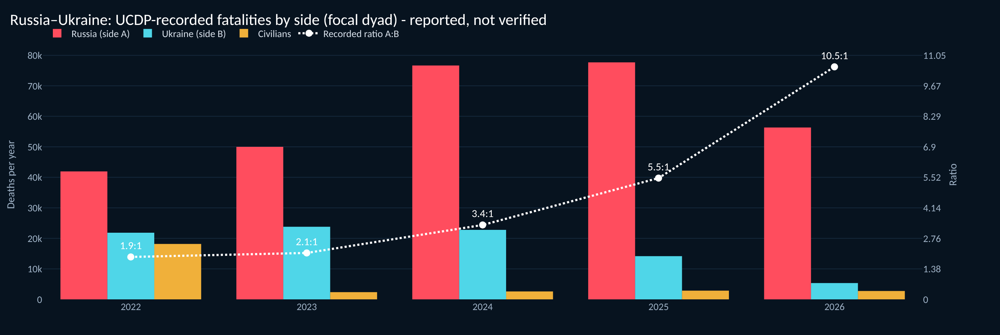
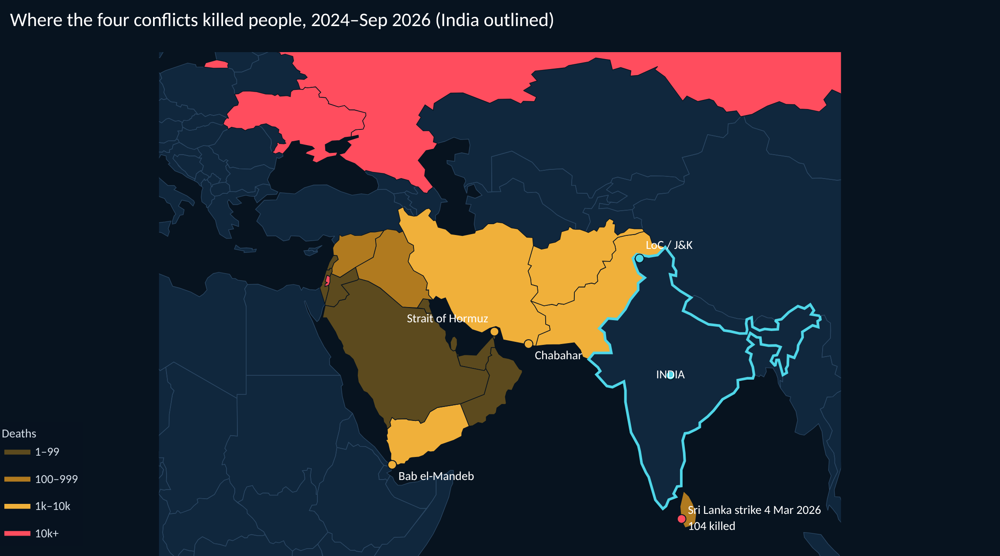
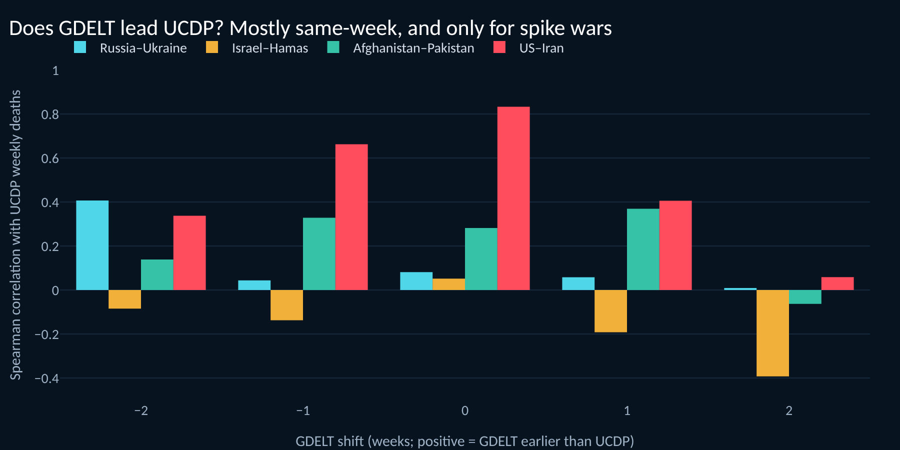
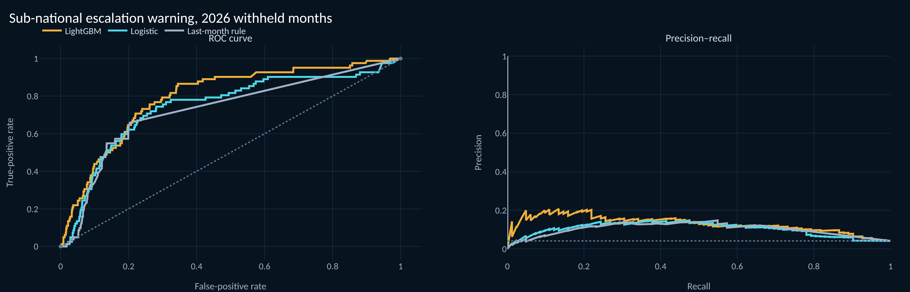

DATA ANALYTICS COMPETITION 2026

<h1 class="title">CONFLICT WATCH</h1>

When and where will conflict deaths rise next, and what does it mean for India?

Maj Shivam Mehta · Capt Siddharth Sangwan · Capt Sahil Singh | Analysis report · data to 30 Sep 2026 · run CW-8694DE2B · UNCLASSIFIED – open-source data only

## 1 · Bottom line up front

* **Threat picture (Oct 2026).** Russia–Ukraine is <b class="red">RED</b>: an active high-intensity war forecast at
  **6,780 deaths** next month. Afghanistan–Pakistan
  and US–Iran are <b class="amber">AMBER</b>: Af–Pak has three escalation hotspots and a new interstate front, and
  US–Iran is volatile after its Feb–Mar 2026 war. Israel–Hamas is <b class="green">GREEN</b>, meaning low risk of
  escalation, not peace: it still records about 130 deaths a month.
* **The fronts are widening, not moving.** In Ukraine, Donetsk's share of located events fell from
  **55% to 30%** (2022 → 2026). The US–Iran war hit **14 countries in 2026**, up
  from 4 in 2025.
* **Pakistan now has a two-front problem.** TTP violence in Khyber Pakhtunkhwa has grown every year since 2021, and since
  Oct 2025 the Afghan and Pakistani **governments fight each other directly** (peak: 411 deaths, Mar 2026).
* **The war reached India's neighbourhood.** In 2026 strikes hit 5 Gulf states that host the Indian diaspora
  (25 events), Iran's Hormuz/Chabahar coast (299 deaths) and Sri Lankan waters
  (**104 killed, 4 Mar 2026**).
* **Forecasting works on unseen data.** Trained only on 2014–2025, the ensemble cut 1-month-ahead error against the
  "no-change" rule by **29%** on Jan–Sep 2026 (90% interval 2% to 41%). Its 80% bands held
  **83%** of 2026 outcomes overall, but only 22% for US–Iran (§7.4).
* **Warning works sub-nationally.** A month ahead, the escalation classifier ranks 222 areas with ROC-AUC
  **0.79** on 2026 (rule of thumb: 0.73). Its top-10 watch-list is
  **3.5× better than random** (90% interval 2.2× to 5.0×).
* **Limit.** No model built on death counts foresees a *decision* to go to war (Feb 2022, Feb 2026). Warning must watch
  spread and hotspots, not media volume: references follow incidents, not lethality, and do not lead escalation.

**Recommendations in brief:** task ISR on the monthly watch-list; keep Gulf NEO plans current while US–Iran is AMBER;
treat the Af–Pak interstate dyad as a standing I&W indicator for the LoC; build Indian OSINT coverage of West Asia (§9).

**Threat scorecard for Oct 2026**, built only from model outputs (rules in §8):

| Conflict | Escalation risk | Oct 2026 forecast | 80% band | Trend vs 6 mo (%) | Hotspots | Top areas (probability) | Pts |
|---|---|---|---|---|---|---|---|
| Russia–Ukraine | <b class="red">RED</b> | 6,780 | 3,316–16,708 | +7 | 0 | Chernihiv (15%); Dnipropetrovsk (14%); Sumy (14%) | 3 |
| Israel–Hamas | <b class="green">GREEN</b> | 128 | 62–317 | -4 | 0 | Gaza Strip (14%); West Bank (11%); Haifa district (1%) | 1 |
| Afghanistan–Pakistan | <b class="amber">AMBER</b> | 318 | 155–786 | +12 | 3 | Kandahar (23%); Balochistan (21%); Kunar (21%) | 3 |
| US–Iran | <b class="amber">AMBER</b> | 26 | 12–66 | -78 | 1 | Hormozgan (16%); Khuzestan (12%); Kermanshah (9%) | 2 |

## 2 · Problem framing

The brief asks teams to explore four conflicts, frame their own questions, and show verifiable findings with stated
assumptions. For an audience of military officers we chose an **operational** framing: *when and where will conflict
deaths rise next, and what does that mean for the Indian Armed Forces and for humanitarian planning?* We chose it over a
purely descriptive study because a forecast can be scored against withheld data and turned into tasking.

| # | Question | Method | § |
|---|---|---|---|
| Q1 | How intense is each conflict, and how is it changing? | Monthly panels, tempo, lethality, seasonality | 5.1 |
| Q2 | How are the wars fought: attrition, front geography, spread? | Dyad/side analysis, located-event shares, theatre spread | 5.2 |
| Q3 | Can we forecast monthly deaths better than simple rules, on unseen 2026 data? | 7 models, walk-forward back-test, 2026 holdout, conformal intervals | 7 |
| Q4 | Can we warn which areas will escalate next month? | Sub-national classifier, watch-list precision | 8 |
| Q5 | What does it mean for India? | Exposure analysis plus labelled domain reasoning | 6 |

**[Data]** marks results computed from the competition files. **[Domain]** marks expert reasoning the files cannot prove.

## 3 · Data, cleaning and imputation

**Sources (official participant package).** 61,055 UCDP event records (GED 26.1 for 2014–2025; provisional
Candidate 26.01.26.09 for Jan–Sep 2026), 85,406 source references, UNHCR bilateral stocks (6,273 rows) and demographics
(19,830), IDMC/UNRWA reference stocks (112) and World Bank context (1,764). The top-level files outside the official folder
belong to another package and were **not** used.

**36 documented checks**, of which 23 found something to handle. No row is silently
dropped: every fix is logged, and raw values are kept beside corrected ones. The ten that matter most are below; all
23 are in **Appendix A** and `outputs/tables/data_quality_log.csv`.

| ID | Issue found | Rows | What we did |
|---|---|---|---|
| DQ05 | Out-of-order low/best/high estimates (low<=best<=high violated) | 692 | Raw values preserved |
| DQ07 | Event date range crosses a month boundary | 731 | Fatalities allocated across months in proportion to days in range (uniform-day disaggregation) instead of assigning everything to the start month |
| DQ10 | Provisional UCDP Candidate records (Jan-Sep 2026) | 4,644 | Flagged is_provisional |
| DQ13 | Administrative boundary change: FATA merged into Khyber Pakhtunkhwa (2018) | 602 | Harmonised FATA to 'Khyber Pakhtunkwa province' (post-merger boundary) for a stable sub-national panel; raw admin1_name retained |
| DQ14 | Blank admin1_name | 3,043 | Imputed category '(country-level / unspecified)' so the events remain in sub-national panels |
| DQ15 | Aggregate event records (event_clarity = 2) | 5,757 | Kept (they carry real deaths) and flagged; event COUNT features use clear events only |
| DQ23 | Publisher name variants (e.g. ITAR-TASS/Tass, UA Losses/UALosses) | 90 | Normalised 1,714 raw labels to 1,624 outlets (case, punctuation, prefix, alias map) |
| DQ24 | Same outlet + same date repeated within one event | 7,515 | Kept (README: references can repeat an outlet/date) but flagged; 'unique outlets' feature de-duplicates them |
| DQ29 | Unspecified sex/age cells ('_X') | 6,596 | Kept as an explicit 'Unspecified' level; shares computed over specified cells only and coverage reported alongside |
| DQ34 | Missing consumer_inflation_annual_pct | 124 | Within-economy linear interpolation + edge fill; 60 remain blank (economy has no value in any year) and are left missing |

**Imputation rules.** Blank country codes become `INTL` (waters/airspace) or `XXX` (ambiguous code 666); blank admin1
becomes an explicit "country-level" bucket, so those deaths are not lost. A dash in UNHCR "other protection" is nil and
becomes 0. World Bank gaps (36 GDP, 124 inflation values) are interpolated within each economy; because interpolation looks
at later years, **these columns are kept out of the selected ensemble and classifier** and appear only in benchmark and
ablation variants. Area-months with no event are true zeros.

**A finding from cleaning: the fog of war is in the data [Data].** The share of Russia–Ukraine deaths with no sub-national
location rose from 30% (2022) to **92% (2026)**, because most recent
deaths come from country-level memorial and aggregate counts. We therefore measure front geography with **located,
discrete events**.

## 4 · Feature engineering

Two monthly panels: **4 conflicts × 153 months** and **222 sub-national area series × 153 months** (zero-filled). Every
feature is known at the end of the forecast-origin month.

| Family | Features | Military / analytic idea |
|---|---|---|
| Intensity memory | deaths in the last 1–12 months, 3/6/12-month averages, worst month in a year | War has inertia |
| Momentum | last 3 vs last 12 months, month-on-month change, dormancy streak | Escalation = short-term above long-term norm |
| Tempo and fog | events and references per month; (high − low)/best; share of aggregate records | Engagements vs lethality; degraded picture |
| Character | civilian, state-based, one-sided and focal-dyad shares | Battlefield vs punitive violence |
| Geography | active areas, concentration (Herfindahl), share outside the core theatre | Front widening, horizontal escalation |
| Seasonality | calendar month, same month last year | Campaign seasons |
| Hierarchy | whole-conflict and country tempo; area's share of its conflict | Areas inherit their war's tempo |

The ablation in §7.2 shows that **a compact 18-feature subset generalises best** at conflict level: with four series,
40 features over-fit. The richer set is used where data are plentiful (222 area series).

## 5 · Exploratory analysis and findings

### 5.1 Intensity and tempo [Data]

<figure><figcaption>Figure 1 – Monthly deaths by conflict (log scale); shaded = 2026 withheld test window</figcaption></figure>

| | Russia–Ukraine | Israel–Hamas | Afghanistan–Pakistan | US–Iran |
|---|---|---|---|---|
| Recorded deaths 2014–Sep 2026 (low – high) | 447,452 (271k – 783k) | 67,933 (64k – 72k) | 31,082 (29k – 40k) | 7,929 (6.9k – 8.7k) |
| Peak month | Mar 2022 (27,245) | Oct 2023 (11,211) | Feb 2017 (762) | Mar 2026 (2,825) |
| Deaths Jan–Sep 2026 | 64,453 | 1,191 | 2,767 | 3,965 |
| Civilian share · countries with deaths | 7% · 4 | 49% · 9 | 20% · 2 | 36% · 15 |

**Four threat signatures:** RU–UA is sustained attrition (4–11k deaths a month since 2023), US–Iran is spikes (coalition
strikes, then direct war in Feb–Mar 2026), Af–Pak is a creep (rising since 2021) and Israel–Hamas is de-escalating (about
130 a month in 2026). **Campaign seasons:** RU–UA deaths run +35% (May) and +25% (Jul) against
trend, and -27% (Dec) and -34% (Jan); Af–Pak peaks in Sep–Oct. *So what:* one warning rule
cannot fit all four, so we forecast level, trend and spread separately.

### 5.2 How the wars are being fought (military lens)

**Front geography: widening, not moving [Data].** Donetsk's share of located events fell from 55% (2022) to
30% (2026) while Zaporizhzhia (14%), Dnipropetrovsk
(7%), Sumy (6%) and Russia's
Belgorod (5%) grew. Deaths recorded inside Russia peaked at 10,358 in 2024.
*So what [Domain]:* a wide, static front rewards long-range fires, counter-drone, EW and logistics depth.

**Recorded attrition by side [Data, with caveat].** In the RU–UA focal dyad UCDP records
41,929 Russian vs 21,844 Ukrainian fatalities in 2022
(1.9:1), widening to 10.5:1 in 2026. In the 2026 US–Iran
war, Iran's recorded losses were 1,274 against 11
for the Israel–US coalition. These are *recorded* figures: Ukrainian memorial databases document Russian losses more fully
than the reverse, so the ratio is an upper bound of reporting, not a verified exchange ratio.

<figure><figcaption>Figure 2 – Russia–Ukraine: share of located discrete events by area</figcaption></figure><figure><figcaption>Figure 3 – Russia–Ukraine: UCDP-recorded fatalities by side (recorded, not verified)</figcaption></figure>

**Afghanistan–Pakistan: a second front opens [Data].** Violence has concentrated in Khyber Pakhtunkhwa (TTP) and
Balochistan and has risen every year since 2021. Since **Oct 2025 the two states clash directly** (131 deaths in Oct 2025;
172, 411 and 68 in Feb–Apr 2026). *So what [Domain]:* a Pakistan Army committed in the west has less capacity in the east,
or more incentive for diversionary LoC activity. Watch the western front more closely, not less.

<figure><figcaption>Figure 4 – Afghanistan vs Pakistan government clashes (focal dyad), deaths per month</figcaption></figure><figure><figcaption>Figure 5 – Afghanistan–Pakistan deaths by province (FATA harmonised into KP)</figcaption></figure>

**Horizontal escalation [Data].** The US–Iran case spread from 4 countries (2025) to
14 (2026), including five Gulf states and Sri Lankan waters. Israel–Hamas reached Qatar in Sep 2025.

### 5.3 Media attention vs deaths: an original index [Data]

We regress monthly source references on events and deaths (log, conflict fixed effects). The standardised residual is the
**Attention Gap Index (AGI)**: above 0 is over-reported, below 0 is "forgotten" violence. References scale with
**incidents** (elasticity 0.96), not **lethality** (0.01);
R² = 0.96. Per 100 deaths there are 150 references for Israel–Hamas, 54 for RU–UA, 40 for Af–Pak and 35
for US–Iran. The AGI does **not** lead next month's escalation (coefficient -0.047, p =
0.50). In UCDP's record, Indian outlets (mainly PTI) appear in
**17% of Af–Pak events** and almost none elsewhere: the record of
West Asia rests on non-Indian wires. *So what:* do not build warning on media volume.

### 5.4 Displacement and humanitarian planning [Data]

Ukraine, end-2025: about 5.2M refugees abroad and 3.7M IDPs; **72%** of refugees
with recorded sex and age are women or children. Afghanistan: 63% women and
children, 10% under five. Palestine: 2.0M IDPs (IDMC); UNRWA registrations (2.5M) are a
separate series and are never summed. Country-year deaths explain little of the change in displaced stocks (Spearman
0.10, p = 0.18). *So what:* trigger HADR planning on **onset and spread** (our
escalation flags), not death tolls, and stock paediatric and maternal supplies.

<figure><figcaption>Figure 6 – References track events tightly, deaths loosely</figcaption></figure><figure><figcaption>Figure 7 – Where the four conflicts killed people, 2024–Sep 2026 (India outlined)</figcaption></figure>

### 5.5 A second source: GDELT media-coded events, Feb–Nov 2026 [Data, new results]

The competition package also contains GDELT, about 5.4 GB of machine-coded news events. We reduced
541,275 dyad-coded events (RU↔UA, ISR↔PSE/Hamas, AFG↔PAK, USA↔IRN; 2026-02-01 to
2026-11-12, gap 2026-05-01 to 2026-05-16) to daily, weekly and monthly rates per covered day
(`data/gdelt/`, script included). GDELT counts *reports*, not incidents, so we compare it with UCDP and never join
event to event. **This is a separate analysis: it does not change any submitted model number.**

* **It agrees with UCDP only for spike wars.** Month-on-month, GDELT's violent-event rate moves with UCDP deaths for
  US–Iran (ρ = 0.86) and Af–Pak (0.93), not for
  Russia–Ukraine (-0.32) or Israel–Hamas (-0.11).
  Pooled, r = 0.64 (p < 0.001, n = 28 conflict-months). In an attrition
  war, news volume rises with *activity* (summer offensives) while recorded deaths fall.
* **It confirms the attention gap with an independent source.** GDELT carries about
  778 articles per UCDP death for Israel–Hamas and
  781 for US–Iran, against 25 for
  Russia–Ukraine (§5.3).
* **It is a nowcast, not a leading indicator.** Weekly, with conflict effects, GDELT in the *same* week adds to last
  week's UCDP deaths (coefficient 0.61, p < 0.001), but GDELT a week *earlier* adds nothing
  (p = 0.55). Out of sample over 20 weeks, neither beats persistence
  (-15% and -1% change in error). So GDELT does not improve the submitted
  forecasts and we did not add it to them.
* **What it is good for: seeing past UCDP's cut-off.** UCDP ends on 30 Sep 2026; GDELT runs to 12 Nov. For the spike
  wars where it tracks UCDP, it is a fast situational-awareness feed:

| Conflict | Month | Violent events / day | Change vs previous month | Threats / day | Signal | GDELT tracks UCDP here? |
|---|---|---|---|---|---|---|
| Afghanistan–Pakistan | Oct 2026 | 15 | −9% | 2 | STEADY | Yes |
| Afghanistan–Pakistan | 1–12 Nov 2026 | 4 | −75% | 3 | FALLING | Yes |
| Israel–Hamas | Oct 2026 | 125 | 0% | 14 | STEADY | No |
| Israel–Hamas | 1–12 Nov 2026 | 70 | −44% | 7 | FALLING | No |
| Russia–Ukraine | Oct 2026 | 171 | +5% | 42 | STEADY | No |
| Russia–Ukraine | 1–12 Nov 2026 | 129 | −24% | 26 | STEADY | No |
| US–Iran | Oct 2026 | 44 | −43% | 24 | FALLING | Yes |
| US–Iran | 1–12 Nov 2026 | 70 | +59% | 52 | RISING | Yes |

*So what:* in Oct 2026 GDELT was steady for three wars and quieter for US–Iran, which is consistent with the frozen Oct forecasts. **US–Iran is the one to
watch:** in the first 12 days of Nov its violent-event rate rose +59%
and threats (52 a day) roughly doubled. With
the scorecard at AMBER and GDELT tracking UCDP in this war, that justifies keeping Gulf NEO plans current (§9). Falls in
early Nov for Af–Pak and Israel–Hamas rest on 12 days and are not yet a trend.

<figure><figcaption>Figure 8 – GDELT violent events per day vs UCDP weekly deaths, 2026 (shaded = after UCDP ends)</figcaption></figure><figure><figcaption>Figure 9 – Correlation of GDELT with UCDP at different week shifts</figcaption></figure>

## 6 · India impact

| Theatre | What the data show [Data] | What it means for India [Domain] |
|---|---|---|
| Afghanistan–Pakistan | KP deaths up every year since 2021; state-on-state clashes since Oct 2025; deaths in Pakistan-held areas adjoining India/LoC rose from 2 (2022) to 52 (2025) | Pakistan Army committed in the west: risk of diversionary LoC activity, infiltration and TTP/IS-K spill-over |
| US–Iran / Gulf | 14 countries hit in 2026, incl. 5 Gulf states (25 events, 37 deaths); 299 deaths on Iran's Hormuz/Chabahar coast; 945 deaths in Yemen in 2025 | About 9M Indians in the Gulf need NEO contingency (cf. Op Ganga, Kaveri, Ajay); crude and LPG transit Hormuz; Chabahar and INSTC lie in the strike zone |
| Indian Ocean | 104 killed in one strike off Sri Lanka's west coast, 4 Mar 2026 | The war entered India's maritime neighbourhood: IFC-IOR and Navy need a belligerent-movement picture |
| Russia–Ukraine | 4–11k deaths a month; front widening; extreme recorded attrition asymmetry | Spares for legacy Russian platforms at risk; drone, counter-drone and EW lessons |
| Israel–Hamas | De-escalated to about 130 a month in 2026 | A key supplier of UAVs, missiles and sensors is at war: hold buffer stocks |
| Refugees in India | Afghans 16,247 (2021) → 8,377 (2025); Russian asylum seekers 5 (2015) → 329 (2025) | Small numbers; monitor the rising Russian flow |

## 7 · Forecasting model

### 7.1 Protocol and models
Models are fitted once on data up to December *Y − 1*, frozen, and scored on Jan–Sep of year *Y*. **Track A
(operational)** is 1 month ahead, rolling, with no refitting. **Track B (strategic)** is 1–9 months ahead from a single
December origin. Back-test folds 2022–2025 drive every design choice (ablation, ensemble membership, interval
calibration). **2026 is the withheld test set, scored once.** RMSLE is the selection metric because the four series differ
by three orders of magnitude; MAE, RMSE, MAPE, sMAPE and MASE are in `outputs/tables/forecast_scores.csv` (definitions in
Appendix B). Candidates: naive, seasonal naive and 3-month mean (benchmarks); ETS (damped Holt, log); SARIMA (AIC-selected,
log); **LightGBM-Δ** (one global model that learns the change in log deaths from 18 features); bottom-up Tweedie LightGBM
(222 areas summed). **Ensemble** = Moving average + ETS + LightGBM-Δ global, a log-space mean.

### 7.2 Why these choices: ablation (back-test only)

| LightGBM variant | RMSLE Track A (1-step) | RMSLE Track B (1-9 step) |
|---|---|---|
| A. Level target, L2, full features (default ML) | 1.232 | 1.197 |
| B. Δ target, L2, full features | 0.993 | 1.260 |
| C. Δ target, L2, full features, regularised | 0.955 | 1.283 |
| D. Δ target, Huber, compact features | 0.896 | 1.143 |
| E. Δ target, L1, compact features (selected) | 0.902 | 1.128 |
| F. Tweedie on raw counts, full features | 1.331 | 1.263 |

A plain LightGBM on the log **level** is the worst option. Trees cannot predict beyond the range seen in training, so a
model fitted before 2022 can never forecast the invasion. Predicting the **change** removes that ceiling, and a compact
feature set with a robust L1 loss generalises best. Deep learning was not used: four series of 153 months are far too few.

### 7.3 Results on the withheld 2026 data

**RMSLE, lower is better** (A = 1 month ahead; B = 1–9 months from December)

| model | A · Back-test 2022–25 | A · 2026 holdout | B · Back-test 2022–25 | B · 2026 holdout |
|---|---|---|---|---|
| Ensemble (log-space mean, members chosen on back-test) | 0.839 | 0.845 | 1.142 | 1.169 |
| ETS (damped Holt, log) | 0.867 | 0.897 | 1.196 | 1.062 |
| LightGBM-Δ global (change in log deaths, L1) | 0.902 | 0.908 | 1.128 | 1.249 |
| Moving average (3 months) | 0.907 | 1.014 | 1.182 | 1.464 |
| Naive (last month) | 0.928 | 0.961 | 1.311 | 1.372 |
| SARIMA (AIC-selected, log) | 1.065 | 0.844 | 1.532 | 1.042 |
| LightGBM bottom-up, Tweedie (sub-national, summed) | 1.293 | 0.933 | 1.208 | 1.003 |
| Seasonal naive (same month last year) | 1.798 | 1.579 | 1.798 | 1.579 |

**1 month ahead on 2026: error against the "no-change" rule**, with 90% moving-block bootstrap intervals and one-sided
Diebold–Mariano (DM) tests

| | MAE ensemble | MAE naive | Reduction (90% interval) | DM p | 80% band coverage |
|---|---|---|---|---|---|
| Russia–Ukraine | 563 | 805 | 30% (−3% to 39%) | 0.11 | 100% |
| Israel–Hamas | 17 | 39 | 55% (27% to 66%) | 0.02 | 100% |
| Afghanistan–Pakistan | 123 | 128 | 4% (−24% to 29%) | 0.44 | 100% |
| US–Iran | 445 | 643 | 31% (−10% to 68%) | 0.19 | 22% |
| **Pooled** |  |  | **29% (2% to 41%)** | 0.05 | 81% |

**How strong is the evidence?** The pooled gain of 29% is positive in 98% of bootstrap
resamples, and the interval excludes zero for the pool and for Israel–Hamas. It does not exclude zero for
Af–Pak, RU–UA and US–Iran. With nine test months, a Diebold–Mariano test is significant at 5% only for
Israel–Hamas (pooled p = 0.05). Across all five folds
(45 months) the pooled gain is 13% (−3% to 27%).
We therefore claim a **consistent, practically useful gain, not a statistically proven one**. On Track B, SARIMA and the
bottom-up LightGBM edged the ensemble in 2026, though not in the back-test; we report this rather than re-select on the
test set.

<figure><figcaption>Figure 10 – Russia–Ukraine: 1-month-ahead forecast vs actual on the 2026 holdout, 80% band, forward forecast</figcaption></figure><figure><figcaption>Figure 11 – Afghanistan–Pakistan: same view</figcaption></figure>

### 7.4 Reliability for trend forecasting

* **Uncertainty.** Split-conformal intervals from 2022–25 residuals cover **83%** of 2026 outcomes at the 80%
  level. That average hides a split: one month ahead, coverage is 100% for the three
  established wars (bands are conservative) and **22% for US–Iran**, whose war began inside
  the test window. Treat US–Iran bands as too narrow.
* **Direction.** The 1-month forecast called the direction of change correctly in 72% of 2026 conflict-months.
* **If data arrive a month late.** Forecasting month *t* from data to *t − 2* (same frozen method) still beats the matching
  naive rule: MAE 36% lower on 2026 and 22% lower on the back-test.
* **Explainability.** TreeSHAP shows the forecast is driven by last month's level, the change since the month before,
  two-month memory, momentum and volatility, then season: features an officer can reason about.
* **Known failure.** The Feb 2026 US–Iran war began with no build-up in the death series. Political decisions to start
  wars are not forecastable from this data.

**Forward forecast**, deaths per month with 80% band (refitted on all data to Sep 2026):

| Conflict | Oct 2026 | Nov 2026 | Dec 2026 |
|---|---|---|---|
| Russia–Ukraine | 6,780 (3,316–16,708) | 6,765 (3,071–30,447) | 6,735 (3,058–30,316) |
| Israel–Hamas | 128 (62–317) | 129 (58–583) | 123 (55–557) |
| Afghanistan–Pakistan | 318 (155–786) | 316 (143–1,428) | 291 (132–1,313) |
| US–Iran | 26 (12–66) | 26 (11–122) | 24 (11–114) |

## 8 · Early warning, scorecard and what-if

An area **escalates** next month if its deaths are ≥ 10 and ≥ 1.5 × its trailing 3-month mean (about 4% of area-months).
A regularised LightGBM classifier uses 19 features (own intensity and momentum, conflict-wide tempo and spread, country
momentum, season), is trained on months up to Dec *Y − 1* and tested on Jan–Sep *Y* for 2023–2026.

| 2026 withheld | ROC-AUC | PR-AUC | Brier | Top-10 precision | Top-20 recall |
|---|---|---|---|---|---|
| **LightGBM classifier** (90% interval) | **0.795** (0.75–0.83) | **0.133** (0.10–0.18) | 0.038 | **14.4%** (9%–21%) | 32.7% |
| Logistic regression (5 signals) | 0.745 | 0.103 | 0.041 | 6.7% | 34.6% |
| Rule: last month's deadliest | 0.727 | 0.088 | 0.049 | 4.4% | 21.8% |
| Base rate | | 0.041 | | 4.1% | |

The top-10 list is **3.5× better than random** and
3.3× better than the rule of thumb (intervals: areas resampled). The
leading signals are the area's own smoothed intensity, **its country's** intensity and momentum and the **whole
conflict's** momentum and spread: escalation is contagious within a theatre. **Calibration:** the scores rank areas well
but run high at the top end. Areas scored 15% or more (mean 25%) escalated
15% of the time in 2026. Use the watch-list as a **ranking, not as literal odds**.

<figure><figcaption>Figure 12 – ROC and precision–recall on 2026 withheld months</figcaption></figure><figure><figcaption>Figure 13 – Predicted probability vs share that escalated, 2026</figcaption></figure>

**Watch-list for Oct 2026.** Kandahar, Balochistan and Kunar (Af–Pak, 21–23%), then Hormozgan (US–Iran, 16%) and
Chernihiv, Dnipropetrovsk and Sumy (RU–UA, 14–15%). The dashboard lists the top 20.

**Scorecard rules.** Points: **intensity** (forecast ≥ 1,000 → 2; ≥ 100 → 1); **trend** vs the last 6 months (≥ +20% →
+1; ≤ −20% → −1); **hotspots** (areas scored ≥ 15%: ≥ 3 → 2; ≥ 1 → 1); **spread** (more countries than last year → 1);
**volatility** (a ≥ 1,000-death month in the last year → 1). **RED** = forecast ≥ 1,000 or ≥ 5 points; **AMBER** = 2–4;
**GREEN** ≤ 1. The rating measures escalation risk relative to the conflict's own recent level.

**What-if and new data.** The dashboard re-runs the ensemble on a modified history: a +30% surge in Af–Pak deaths over
three months raises the Oct 2026 forecast by about 13% (318 → 359). `python score_holdout.py --events <file>` scores the
forecasts and watch-list frozen in this submission against any new month of events, without refitting.

## 9 · Recommendations

| Line | Action | Triggering finding [Data] | Lead [Domain] | When |
|---|---|---|---|---|
| **SENSE** | Task ISR and analysts on the monthly sub-national watch-list; track active sectors and countries hit | Top-10 list 3.5× random (§8) | DIA / Service intelligence | Now |
| **SENSE** | Build Indian OSINT coverage of the Gulf, Iran and Red Sea; run a GDELT feed as a nowcast past UCDP's lag for spike wars | Indian outlets in 17% of Af–Pak events, about 0% elsewhere; GDELT tracks UCDP for US–Iran (§5.3, §5.5) | DIA / MEA | 90 days |
| **WARN** | Adopt the Af–Pak interstate dyad and KP/Balochistan scores as standing LoC I&W indicators | State clashes since Oct 2025; 3 hotspots (§5.2, §8) | Northern / Western Comds | Now |
| **WARN** | Publish the scorecard monthly; escalate any move to RED or rise in countries hit | US–Iran 4 → 14 countries with no build-up (§5.2) | HQ IDS | 90 days |
| **SHIELD** | Keep Gulf NEO plans current while US–Iran is AMBER; sealift/airlift options | 5 Gulf states struck, 25 events (§6) | HQ IDS / Navy / IAF / MEA | Now |
| **SHIELD** | Belligerent-movement picture for the IOR | 104 killed off Sri Lanka, 4 Mar 2026 (§6) | Navy / IFC-IOR | 90 days |
| **SUSTAIN** | Buffer and indigenise critical spares for Russian- and Israeli-origin platforms | RU–UA 4–11k deaths a month, no decline forecast (§7) | MoD / DPSUs | 6–12 months |
| **SUSTAIN** | HADR kits weighted to women, children and under-fives; trigger on escalation flags | 72% of Ukrainian refugees are women or children (§5.4) | HQ IDS / NDMA | 6–12 months |

## 10 · Assumptions, limitations, tools and reproducibility

* UCDP records **reported** lethal violence; coverage depends on access, and side-specific attrition reflects reporting asymmetry.
* 2026 data are **provisional** (Candidate) and usually revised upward, so holdout error includes revision noise.
* Over 90% of 2026 RU–UA deaths have no sub-national location, so sub-national claims about Ukraine rest on events.
* The US–Iran focal dyad codes **Israel and the US as one actor**; no country split is possible.
* Displacement stocks cannot be attributed to single events; IDMC and UNRWA series are kept separate.
* Nine test months per conflict is a small sample: see the intervals in §7.3 and §8.
* Forecasts cannot anticipate decisions to start wars, and US–Iran intervals under-cover (§7.4).
* GDELT (§5.5) covers only Feb–Nov 2026 with a 16-day gap, counts reports not incidents, and over-represents US-linked news.
* Map boundaries follow the Government of India's depiction. [Domain] statements are expert reasoning and are labelled.

**Tools.** Python 3.13: pandas, NumPy, SciPy, statsmodels (ETS, SARIMA), LightGBM (forecaster, classifier, TreeSHAP),
scikit-learn, Plotly and Streamlit (dashboard), python-pptx. **AI tools used: Claude (Anthropic), as a coding, drafting
and review assistant.** It helped write and debug the pipeline, dashboard, report and slide code, and reviewed the
submission against the marking scheme. **No number was typed in or generated by an AI tool: every figure is computed by
the code in this repository from the issued dataset and can be reproduced with one command. The team framed the
questions, checked the analysis and owns the findings and recommendations.**

**Reproduce.** `pip install -r requirements-dev.txt`, then `python run_pipeline.py` (about 4 min: clean → features →
insights → models → evidence checks → figures), `streamlit run app/app.py`, `python score_holdout.py --selftest`. Seeds
are fixed (`random_state = 42`). Every number here is read from `outputs/tables/`; the run ID **CW-8694DE2B** is a hash of the
result tables and is printed on this report, the deck and the dashboard, so all three can be matched. Live:
conflictmonitor2026.streamlit.app.

## Appendix A · Data-quality log (all issues found)

| id | table | check | rows_affected | pct_affected | action |
|---|---|---|---|---|---|
| DQ05 | conflict_events | Out-of-order low/best/high estimates (low<=best<=high violated) | 692 | 1.13 | Raw values preserved. Corrected copies deaths_low_c = min(low,best,high) and deaths_high_c = max(low,best,high); row flagged flag_estimate_order. |
| DQ07 | conflict_events | Event date range crosses a month boundary | 731 | 1.20 | Fatalities allocated across months in proportion to days in range (uniform-day disaggregation) instead of assigning everything to the start month. |
| DQ08 | conflict_events | Date range extends beyond the 30 Sep 2026 extract window | 1 | 0.00 | Kept. Only the in-window share of deaths enters the monthly panel; out-of-window share is logged. |
| DQ09 | conflict_events | Low date precision (code 4-5: month or longer) | 792 | 1.30 | Kept and flagged. Used as a feature (share of imprecise events = reporting fog). |
| DQ10 | conflict_events | Provisional UCDP Candidate records (Jan-Sep 2026) | 4,644 | 7.61 | Flagged is_provisional. 2026 is used ONLY as the withheld test set, never for training the evaluated models. |
| DQ11 | conflict_events | UCDP coding status under review ('Check ...') | 176 | 0.29 | Kept and flagged flag_coding_check; sensitivity analysis excludes them. |
| DQ12 | conflict_events | Blank location_iso3 (code 666 ambiguous / international waters or airspace) | 38 | 0.06 | Imputed join key: 'INTL' for international waters/airspace (precision 7), 'XXX' for ambiguous code 666. Source labels retained. |
| DQ13 | conflict_events | Administrative boundary change: FATA merged into Khyber Pakhtunkhwa (2018) | 602 | 0.99 | Harmonised FATA to 'Khyber Pakhtunkwa province' (post-merger boundary) for a stable sub-national panel; raw admin1_name retained. |
| DQ14 | conflict_events | Blank admin1_name | 3,043 | 4.98 | Imputed category '(country-level / unspecified)' so the events remain in sub-national panels. |
| DQ15 | conflict_events | Aggregate event records (event_clarity = 2) | 5,757 | 9.43 | Kept (they carry real deaths) and flagged; event COUNT features use clear events only. |
| DQ16 | conflict_events | Extreme fatality records (> 99.9th pct = 1225) | 62 | 0.10 | Kept: verified as multi-day aggregates (mostly RU-UA front-wide monthly totals). Models use log1p target and robust (MAE-based) evaluation. |
| DQ17 | conflict_events | Zero-fatality events (deaths_best = 0) | 1,294 | 2.12 | Kept: UCDP retains events whose best estimate is 0 if low/high > 0 or in an active dyad. |
| DQ18 | conflict_events | Monthly allocation outside panel window (after Sep 2026) | 1 | 0.00 | Dropped allocation rows after the window (0.5 deaths, i.e. the October share of a September-start record). |
| DQ22 | event_sources | Publisher labels with spreadsheet 'Source:' prefix | 870 | 1.02 | Prefix stripped in publisher_norm. |
| DQ23 | event_sources | Publisher name variants (e.g. ITAR-TASS/Tass, UA Losses/UALosses) | 90 | 5.25 | Normalised 1,714 raw labels to 1,624 outlets (case, punctuation, prefix, alias map). |
| DQ24 | event_sources | Same outlet + same date repeated within one event | 7,515 | 8.80 | Kept (README: references can repeat an outlet/date) but flagged; 'unique outlets' feature de-duplicates them. |
| DQ25 | event_sources | Reference published before the event's end date | 253 | 0.30 | Kept (README: references may precede an event, e.g. aggregate updates). Lag clipped at 0 for reporting-latency statistics. |
| DQ27 | bilateral_displacement_stocks | Blank other_international_protection (source dash) | 6,269 | 99.94 | Imputed 0: in UNHCR tables a dash denotes nil / not applicable (documented in data dictionary). Flag retained. |
| DQ29 | unhcr_demographics | Unspecified sex/age cells ('_X') | 6,596 | 33.26 | Kept as an explicit 'Unspecified' level; shares computed over specified cells only and coverage reported alongside. |
| DQ30 | displacement_reference_stocks | Two non-comparable series (IDMC IDPs vs UNRWA registrations) | 112 | 100.00 | series_code kept as a key on every summary; the series are never summed. |
| DQ31 | displacement_reference_stocks | Unknown reporting area (UNK) | 1 | 0.89 | Kept in series totals, excluded from country joins. |
| DQ33 | country_year_context | Missing gdp_growth_annual_pct | 36 | 2.04 | Within-economy linear interpolation + edge fill; 12 remain blank (economy has no value in any year) and are left missing. |
| DQ34 | country_year_context | Missing consumer_inflation_annual_pct | 124 | 7.03 | Within-economy linear interpolation + edge fill; 60 remain blank (economy has no value in any year) and are left missing. |

## Appendix B · Metric definitions and evidence methods

MAE = mean |error|; RMSE = √mean(error²); MAPE = mean |error|/actual over months with actual > 0; sMAPE = mean
2|e|/(|y|+|ŷ|); MASE = MAE / in-sample MAE of the one-step naive; RMSLE = √mean(log(1+ŷ) − log(1+y))²; coverage = share of
actuals inside the interval; ROC-AUC/PR-AUC for ranking; Brier = mean squared probability error; precision@10 = share of
each month's top-10 areas that escalated. **Bootstrap:** 5,000 moving-block resamples of months
(block 3; all conflicts resampled together for the pool), 5th–95th percentiles. **Diebold–Mariano:**
absolute-error loss, one-sided (ensemble better), Harvey–Leybourne–Newbold small-sample correction. **Early-warning
intervals:** 1,000 resamples of areas. **Calibration** (2026, LightGBM):

| Predicted band | Area-months | Mean predicted | Escalated |
|---|---|---|---|
| (0, 0.02] | 1,267 | 0.8% | 0.9% |
| (0.02, 0.05] | 346 | 3.3% | 7.2% |
| (0.05, 0.1] | 167 | 7.3% | 6.6% |
| (0.1, 0.15] | 71 | 12.5% | 16.9% |
| (0.15, 0.25] | 84 | 19.1% | 11.9% |
| (0.25, 1.0] | 63 | 33.9% | 19.0% |
