<div class="cover">
<div class="kick">DATA ANALYTICS COMPETITION 2026</div>
<h1 class="title">CONFLICT WATCH</h1>
<div class="subtitle">When and where will conflict deaths rise next, and what does it mean for India?<br/>
Russia–Ukraine · Israel–Hamas · Afghanistan–Pakistan · US–Iran</div>
<div class="author"><span style="font-weight:400;font-size:10pt;color:#F0B03A;letter-spacing:2px">TEAM</span><br/>Maj Shivam Mehta<br/>Capt Siddharth Sangwan<br/>Capt Sahil Singh</div>
<div class="meta">Analysis report · data to 30 Sep 2026 · UNCLASSIFIED – open-source data only</div>
</div>

<div class="pagebreak"></div>

## 1 · Bottom line up front

* **Threat picture (Oct 2026).** Russia–Ukraine is <b class="red">RED</b>: an active high-intensity war forecast at
  **6,780 deaths** next month. Afghanistan–Pakistan
  and US–Iran are <b class="amber">AMBER</b>: Af–Pak has three escalation hotspots and a new interstate front, and
  US–Iran is volatile after its Feb–Mar 2026 war. Israel–Hamas is <b class="green">GREEN</b>: it has de-escalated to
  about 130 deaths a month.
* **The fronts are widening, not moving.** In Ukraine, Donetsk's share of located events fell from
  **55% to 30%** (2022 → 2026) as violence spread to Zaporizhzhia, Dnipropetrovsk, Sumy and into
  Russia. The US–Iran war hit **14 countries in 2026**, up from 4 in 2025.
* **Pakistan now has a two-front problem.** The TTP insurgency in Khyber Pakhtunkhwa has grown every year since 2021,
  and since Oct 2025 the Afghan and Pakistani **governments fight each other directly** (peak: 411 deaths, Mar 2026).
* **The war reached India's neighbourhood.** In 2026 strikes hit 5 Gulf states that host the
  Indian diaspora (25 events), Iran's Hormuz/Chabahar coast (299 deaths),
  and Sri Lankan waters (**104 killed, 4 Mar 2026**).
* **Forecasting works on unseen data.** Trained only on 2014–2025, our ensemble cut 1-month-ahead error against
  the "no-change" rule by **29%** overall on Jan–Sep 2026 (30% for RU–UA,
  55% for Israel–Hamas). Its 80% intervals contained **83%** of 2026 outcomes.
* **Warning works sub-nationally.** A month ahead, the escalation classifier ranks 222 area series with
  ROC-AUC **0.79** on 2026 (rule of thumb: 0.73). Its top-10 watch-list is
  **3.5× better than random**.
* **Limit.** No model built on death counts foresees a *decision* to go to war (Feb 2022, Feb 2026). Indications and
  warning must watch spread and hotspots, and **not media volume**: references follow incidents, not lethality, and
  do not lead escalation.

**Recommendations, in brief:** task ISR on the monthly escalation watch-list. Keep Gulf NEO plans current while US–Iran is
AMBER. Treat the Af–Pak interstate dyad as a standing I&W indicator for the LoC. Build indigenous OSINT coverage of
West Asia: Indian outlets appear in 17% of Af–Pak events and almost
none elsewhere. See §9.


<figure>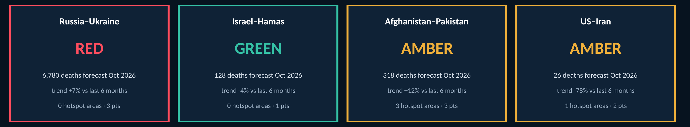<figcaption>Figure 1 – Threat scorecard for Oct 2026, built only from model outputs (rules in §8.3)</figcaption></figure>


| Conflict | Rating | Oct 2026 forecast | 80% low | 80% high | Trend vs 6 mo (%) | Hotspot areas | Top escalation areas (probability) | Points |
|---|---|---|---|---|---|---|---|---|
| Russia–Ukraine | RED | 6,780 | 3,316 | 16,708 | +7 | 0 | Chernihiv (15%); Dnipropetrovsk (14%); Sumy (14%) | 3 |
| Israel–Hamas | GREEN | 128 | 62 | 317 | -4 | 0 | Gaza Strip (14%); West Bank (11%); Haifa district (1%) | 1 |
| Afghanistan–Pakistan | AMBER | 318 | 155 | 786 | +12 | 3 | Kandahar (23%); Balochistan (21%); Kunar (21%) | 3 |
| US–Iran | AMBER | 26 | 12 | 66 | -78 | 1 | Hormozgan (16%); Khuzestan (12%); Kermanshah (9%) | 2 |

## 2 · Problem framing

The brief asks teams to explore four conflicts, frame their own questions, and show verifiable, reproducible
findings with stated assumptions. For an audience of military officers we chose an **operational** framing:

> **When and where will conflict deaths rise next, and what does that mean for the Indian Armed Forces and for
> humanitarian planning?**

| # | Question | Method | Section |
|---|---|---|---|
| Q1 | How intense is each conflict, and how is it changing? | Monthly panels, tempo, lethality, seasonality | 5.1 |
| Q2 | How are the wars fought: attrition, violence type, front geography, spread? | Dyad/side analysis, geolocated-event shares, theatre spread | 5.2 |
| Q3 | Can we forecast monthly deaths better than simple rules, on unseen 2026 data? | 7 models, walk-forward back-test, 2026 holdout, conformal intervals | 7 |
| Q4 | Can we warn which areas will escalate next month? | Sub-national classifier, watch-list precision | 8 |
| Q5 | What does it mean for India? | Exposure analysis + clearly labelled domain reasoning | 6 |

Throughout, **[Data]** marks results computed from the competition files and **[Domain]** marks expert reasoning
that the files cannot prove.

## 3 · Data and preparation

**Sources (official package only).** 61,055 UCDP event records (GED 26.1 for 2014–2025; provisional
Candidate 26.01.26.09 for Jan–Sep 2026), 85,406 source references, UNHCR bilateral stocks (6,273 rows) and
demographics (19,830), IDMC/UNRWA reference stocks (112) and World Bank context (1,764). The top-level files outside
the official folder belong to another package and were **not** used.

**36 documented checks**, of which 23 found something to handle. No row is
silently dropped: every fix is logged, and raw values are kept beside corrected ones.


<figure>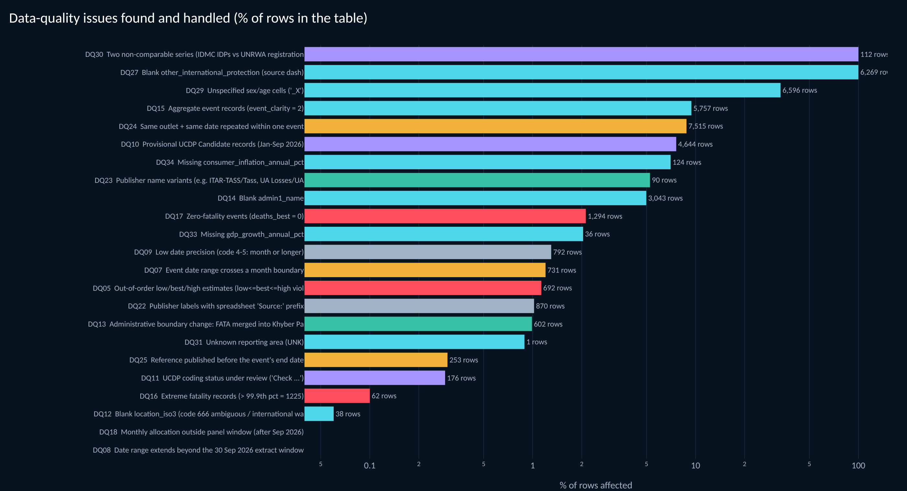<figcaption>Figure 2 – Data-quality issues found and handled (log scale, % of table rows)</figcaption></figure>


Key decisions:

* **Out-of-order estimates (692 rows).** Where low > best or best > high, we keep the raw values and build a corrected
  band (`min`/`max` of the three). We widen the band rather than move *best*, because *best* reconciles exactly with the
  four fatality components (validated for every row).
* **Multi-month records (731 rows).** These include front-wide monthly aggregates. Deaths are spread across calendar
  months in proportion to the days in the date range. Stacking them on the start month would create false spikes.
* **Provisional 2026 data (4,644 rows).** Flagged and used **only** as the withheld test set.
* **Boundary change.** Pakistan merged FATA into Khyber Pakhtunkhwa in 2018. UCDP labels change at that point, which
  would fake a collapse of violence in FATA and a surge in KP. We harmonise to the post-merger boundary.
* **Publisher normalisation.** 1,715 raw labels become 1,625 outlets (e.g. ITAR-TASS and Tass; UA Losses and UALosses).
  7,515 repeat references (same outlet and date within one event) are flagged.
* **Missing geography.** Blank country codes become `INTL` (waters/airspace) or `XXX` (ambiguous code 666). Blank admin1
  becomes an explicit "country-level" bucket, so those deaths are not lost.
* **World Bank gaps.** 36 GDP and 124 inflation values are interpolated within each economy. Context enters models with a
  one-year lag, so 2026 needs no extrapolation.

**A finding from cleaning: the fog of war is in the data.** The share of Russia–Ukraine deaths with no sub-national
location rose from 30% (2022) to **92% (2026)**, because most
recent deaths come from country-level memorial and aggregate counts. We therefore measure front geography with
**located, discrete events**, and we state this limit wherever sub-national results touch Ukraine.


<figure>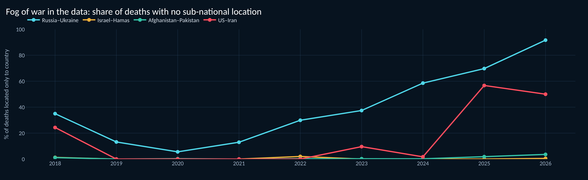<figcaption>Figure 3 – Share of deaths located only to country level</figcaption></figure>


## 4 · Feature engineering

Two monthly panels: **4 conflicts × 153 months** and **222 sub-national area series × 153 months** (zero-filled).
Every feature is known at the end of the forecast-origin month. Annual context is lagged one year.

| Family | Features | Military / analytic idea |
|---|---|---|
| Intensity memory | lags 0–12, rolling means 3/6/12, EWM, 12-month peak | War has inertia |
| Momentum | 3-vs-12-month momentum, acceleration, dormancy streak | Escalation = short-term above long-term norm |
| Tempo | events/month, references/month, outlets | Engagements vs lethality |
| Fog of war | (high − low)/best, aggregate share, low date precision | Degraded reporting picture |
| Character | civilian, state-based, one-sided and focal-dyad shares | Battlefield vs punitive violence |
| Geography | active areas, Herfindahl concentration, share outside core theatre | Front widening, horizontal escalation |
| Seasonality | target-month sine/cosine, same month last year | Campaign seasons |
| Context (t−1 y) | IDPs, refugees, displacement growth, GDP growth, inflation | Structural stress |
| Hierarchy | conflict-level tempo and momentum, area's share of its conflict | Areas inherit their war's tempo |

The ablation in §7.2 shows that **a compact subset generalises best** at conflict level. With four series, 40 features
over-fit. The richer set is used where data are plentiful (222 sub-national series).

## 5 · Findings

### 5.1 Intensity and tempo [Data]


<figure>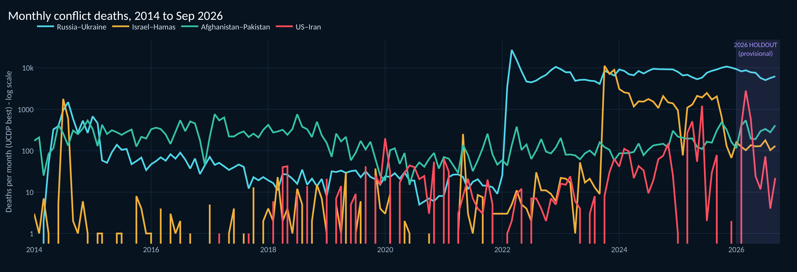<figcaption>Figure 4 – Monthly deaths by conflict (log scale); shaded = 2026 withheld test window</figcaption></figure>


| | Russia–Ukraine | Israel–Hamas | Afghanistan–Pakistan | US–Iran |
|---|---|---|---|---|
| Recorded deaths 2014–Sep 2026 (best) | 447,452 | 67,933 | 31,082 | 7,929 |
| UCDP low – high | 270,529 – 782,980 | 64,292 – 71,893 | 28,784 – 39,746 | 6,878 – 8,742 |
| Peak month | Mar 2022 (27,245) | Oct 2023 (11,211) | Feb 2017 (762) | Mar 2026 (2,825) |
| Deaths Jan–Sep 2026 | 64,453 | 1,191 | 2,767 | 3,965 |
| Civilian share | 7% | 49% | 20% | 36% |
| Countries with deaths | 4 | 9 | 2 | 15 |

Each conflict has a different threat signature: **RU–UA is sustained attrition** (4–11k deaths a month since 2023),
**US–Iran is spikes** (proxy and coalition strikes, then direct war in Feb–Mar 2026), **Af–Pak is creeping** (rising since
2021), and **Israel–Hamas is de-escalating** (about 130 a month in 2026 after a 2,474-death month in Jul 2025).
*So what:* one warning rule cannot fit all four. We forecast level, trend and spread separately.

### 5.2 How the wars are being fought (military lens)

**Front geography – widening, not moving [Data].** Donetsk's share of geolocated events fell from 55% (2022)
to 30% (2026). Zaporizhzhia (14%), Dnipropetrovsk
(7%), Sumy (6%) and Russia's
Belgorod (5%) grew. Recorded deaths inside Russia peaked at 10,358 in 2024
(Kursk). *So what [Domain]:* a wide, static front rewards long-range precision fires, counter-drone and EW, and
logistics depth. Warning should track the **number of active sectors**, which our models do.


<figure><figcaption>Figure 5 – Russia–Ukraine: share of located discrete events by area</figcaption></figure>


**Recorded attrition by side [Data, with caveat].** In the RU–UA focal dyad, UCDP records
41,929 Russian vs 21,844 Ukrainian fatalities in 2022
(ratio 1.9:1), widening to 5.5:1 in 2025 and
10.5:1 in 2026. In the 2026 US–Iran war, Iran's recorded losses were
1,274 against 11 for the Israel–US coalition.
**Caveat:** these are *recorded* figures. Ukrainian OSINT and memorial databases document Russian losses more fully than
the reverse, so the ratio is an upper bound of reporting, not a verified exchange ratio. *So what [Domain]:* stand-off
precision strike, layered air defence and drone-enabled ISR produce extreme asymmetry. These lessons apply directly to
Indian force design on both fronts.


<figure><figcaption>Figure 6 – Russia–Ukraine: UCDP-recorded fatalities by side</figcaption></figure>


**Afghanistan–Pakistan: a second front opens [Data].** Violence has concentrated in Khyber Pakhtunkhwa (TTP) and
Balochistan, and has risen every year since 2021. Since **Oct 2025 the Afghan and Pakistani states clash directly**
(131 deaths in Oct 2025; 172, 411 and 68 in Feb–Apr 2026). *So what [Domain]:* the Pakistan Army is committed in the
west. That can lower its eastern capacity, or raise the incentive for diversionary LoC activity. India should watch the
western front more closely, not less.


<figure><figcaption>Figure 7 – Afghanistan vs Pakistan government clashes (focal dyad), deaths per month</figcaption></figure>


<figure>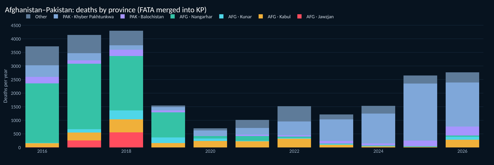<figcaption>Figure 8 – Afghanistan–Pakistan deaths by province (FATA harmonised into KP)</figcaption></figure>


**Horizontal escalation [Data].** The US–Iran case spread from 4 countries (2025) to
14 (2026), including five Gulf states and Sri Lankan waters. Israel–Hamas reached Qatar in Sep 2025.


<figure><figcaption>Figure 9 – Where the four conflicts killed people, 2024–Sep 2026 (India outlined)</figcaption></figure>


**Campaign seasons [Data].** RU–UA deaths run +35% (May) and +25% (Jul) against trend, and
-27% (Dec) and -34% (Jan), matching the summer campaigning season and the winter/*rasputitsa*
lull. Af–Pak peaks in Sep–Oct. Seasonality enters the models.


<figure>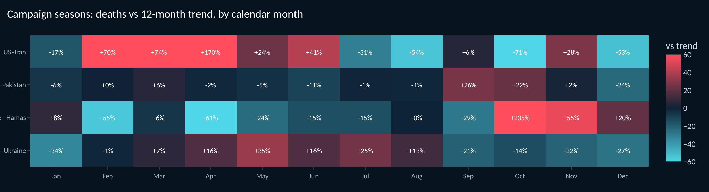<figcaption>Figure 10 – Deaths vs 12-month trend by calendar month</figcaption></figure>


### 5.3 Media attention vs deaths – an original index [Data]

We regress monthly source references on events and deaths (log, with conflict fixed effects). The residual, standardised,
is the **Attention Gap Index (AGI)**: above 0 means over-reported, below 0 means "forgotten" violence.

* References scale with **incidents** (elasticity 0.96) and **not lethality**
  (0.01); R² = 0.96. One mass-casualty strike is one story, so
  high-lethality violence is under-documented per death.
* References per 100 deaths: Israel–Hamas 150, RU–UA 54, Af–Pak 40, US–Iran 35.
* The AGI does **not** lead next month's escalation (coefficient -0.047, p = 0.50).
  *So what:* do not build warning on media volume.
* Indian outlets (mainly PTI) appear in **17% of Af–Pak events** and
  almost none of the other theatres. India's open-source picture of West Asia and Europe is borrowed.


<figure>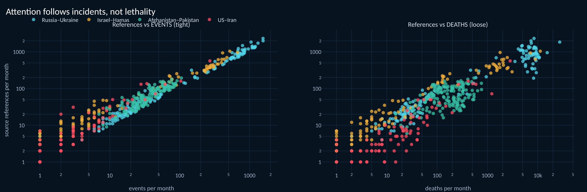<figcaption>Figure 11 – References track events tightly, deaths loosely</figcaption></figure>


### 5.4 Displacement and humanitarian planning [Data]

* Ukraine end-2025: about 5.2M refugees abroad and 3.7M IDPs. **72%** of refugees with
  recorded sex and age are women or children.
* Afghanistan: 63% women and children, 10% under five.
  Refugees abroad fell from 5.8M (2024) to 2.7M (2025) as returns and reclassification (1.03M "other protection")
  took effect.
* Palestine: 2.0M IDPs (IDMC) since 2024. UNRWA registrations (2.5M in Palestine) are a separate series and are never summed.
* Country-year deaths explain little of the *change* in displaced stocks (Spearman 0.10, p =
  0.18). Displacement responds to onset, spread and access, not monthly tolls, and cannot be attributed to
  single events.

*So what:* trigger HADR planning on **onset and spread** (our escalation flags), and stock paediatric and maternal supplies.


<figure>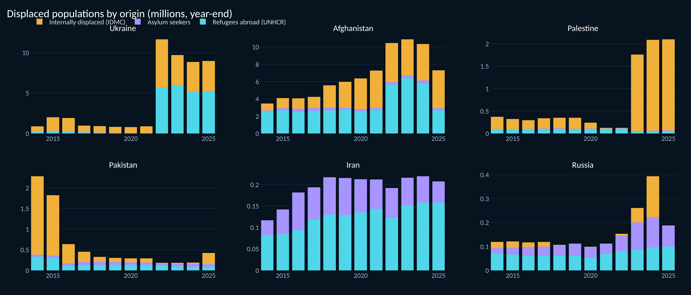<figcaption>Figure 12 – Displaced populations by origin (UNHCR refugees and asylum seekers; IDMC IDPs)</figcaption></figure>


## 6 · India impact

| Theatre | What the data show [Data] | What it means for India [Domain] |
|---|---|---|
| Afghanistan–Pakistan | KP deaths up every year since 2021; Afghan–Pakistan state clashes since Oct 2025; deaths in Pakistan areas adjoining India/LoC rose from 2 (2022) to 52 (2025) | Pakistan Army committed in the west, so risk of diversionary LoC activity, infiltration and TTP/IS-K spill-over |
| US–Iran / Gulf | 14 countries hit in 2026, including 5 Gulf states (25 events, 37 deaths); 299 deaths on Iran's Hormuz/Chabahar coast; 945 deaths in Yemen in 2025 | About 9M Indians in the Gulf need NEO contingency (cf. Op Ganga, Kaveri, Ajay); a large share of crude and LPG transits Hormuz; Chabahar and INSTC lie in the strike zone; Red Sea shipping at risk |
| Indian Ocean | 104 killed in one strike off Sri Lanka's west coast, 4 Mar 2026 | The war entered India's maritime neighbourhood. IFC-IOR and Navy need a belligerent-movement picture |
| Russia–Ukraine | 4–11k deaths a month; front widening; extreme recorded attrition asymmetry | Spares and deliveries for legacy Russian platforms at risk; drone, counter-drone and EW lessons |
| Israel–Hamas | De-escalated to about 130/month in 2026 | Key supplier of UAVs, missiles and sensors at war; buffer stocks |
| Refugees in India | Afghans 16,247 (2021) → 8,377 (2025); Russian asylum seekers 5 (2015) → 329 (2025) | Small numbers; the rising Russian flow is consistent with draft-evasion migration, so monitor |
| Macro | India's inflation was 6.7% in 2022 (World Bank) | Coincides with the energy shock; attribution not claimed |


<figure>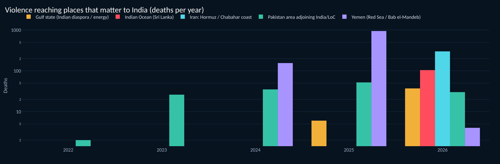<figcaption>Figure 13 – Deaths in places that matter to India (log scale)</figcaption></figure>


## 7 · Forecasting model

### 7.1 Protocol
Models are fitted once on data up to December *Y − 1*, frozen, and scored on Jan–Sep of year *Y* in two ways:

* **Track A (operational):** 1 month ahead, rolling. Each month the frozen model sees the newly observed month and
  forecasts the next. There is no refitting.
* **Track B (strategic):** 1–9 months ahead from a single December origin, with nothing from year *Y*.

Back-test folds 2022–2025 drive **every** design choice: ablation, ensemble membership and interval calibration.
**2026 is the withheld test set**, scored once. Metrics: MAE, RMSE, MAPE (actual > 0), sMAPE, MASE and RMSLE. RMSLE is
the selection metric because the four series differ by three orders of magnitude.

| Model | Role |
|---|---|
| Naive, seasonal naive, 3-month moving average | Benchmarks |
| ETS (damped Holt, log) | Classical smoother for level shifts |
| SARIMA (AIC-selected per series, log) | Autocorrelation and seasonality |
| **LightGBM-Δ** (global across the 4 conflicts) | Learns the *change* in log deaths from 18 features |
| LightGBM bottom-up (Tweedie; 222 area series summed) | Hierarchical, answers *where* |
| **Ensemble** = Moving average + ETS + LightGBM-Δ global | Log-space mean; members chosen on back-test |

### 7.2 Why these choices – ablation (back-test only)

| LightGBM variant | RMSLE Track A (1-step) | RMSLE Track B (1-9 step) |
|---|---|---|
| A. Level target, L2, full features (default ML) | 1.232 | 1.197 |
| B. Δ target, L2, full features | 0.993 | 1.260 |
| C. Δ target, L2, full features, regularised | 0.955 | 1.283 |
| D. Δ target, Huber, compact features | 0.896 | 1.143 |
| E. Δ target, L1, compact features (selected) | 0.902 | 1.128 |
| F. Tweedie on raw counts, full features | 1.331 | 1.263 |

A plain LightGBM on the log **level** is the worst ML option. Regression trees cannot predict beyond the target range
seen in training, so a model fitted before 2022 can never forecast the invasion. Predicting the **change** in log deaths
removes that ceiling. A compact feature set with a robust L1 loss generalises best.

### 7.3 Results on the withheld 2026 data


<figure>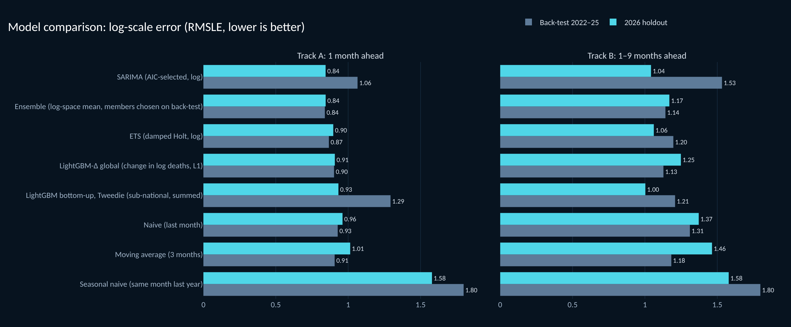<figcaption>Figure 14 – Log-scale error by model: back-test vs 2026 holdout</figcaption></figure>


**RMSLE (lower is better)**

| model | A · Back-test 2022–25 | A · 2026 holdout | B · Back-test 2022–25 | B · 2026 holdout |
|---|---|---|---|---|
| Ensemble (log-space mean, members chosen on back-test) | 0.839 | 0.845 | 1.142 | 1.169 |
| ETS (damped Holt, log) | 0.867 | 0.897 | 1.196 | 1.062 |
| LightGBM-Δ global (change in log deaths, L1) | 0.902 | 0.908 | 1.128 | 1.249 |
| Moving average (3 months) | 0.907 | 1.014 | 1.182 | 1.464 |
| Naive (last month) | 0.928 | 0.961 | 1.311 | 1.372 |
| SARIMA (AIC-selected, log) | 1.065 | 0.844 | 1.532 | 1.042 |
| LightGBM bottom-up, Tweedie (sub-national, summed) | 1.293 | 0.933 | 1.208 | 1.003 |
| Seasonal naive (same month last year) | 1.798 | 1.579 | 1.798 | 1.579 |

**MAE, 2026 holdout, 1 month ahead (deaths per month)**

| model | Russia–Ukraine | Israel–Hamas | Afghanistan–Pakistan | US–Iran |
|---|---|---|---|---|
| Ensemble (log-space mean, members chosen on back-test) | 563 | 17 | 123 | 445 |
| SARIMA (AIC-selected, log) | 686 | 35 | 98 | 434 |
| Naive (last month) | 805 | 39 | 128 | 643 |
| ETS (damped Holt, log) | 805 | 35 | 113 | 438 |
| Moving average (3 months) | 1,166 | 29 | 145 | 684 |
| LightGBM-Δ global (change in log deaths, L1) | 1,439 | 31 | 115 | 433 |
| Seasonal naive (same month last year) | 1,938 | 1,399 | 144 | 494 |
| LightGBM bottom-up, Tweedie (sub-national, summed) | 2,352 | 101 | 148 | 420 |

The ensemble reduces 1-month-ahead MAE against the naive rule by **30%** (RU–UA),
**55%** (Israel–Hamas), **31%** (US–Iran) and
**4%** (Af–Pak); pooled, **29%**. MAPE for RU–UA is
9%.
On Track B (9 months blind), SARIMA and the bottom-up LightGBM edged the ensemble in 2026, though not in the
back-test. We report this rather than re-select on the test set.


<figure><figcaption>Figure 15 – Russia–Ukraine: 1-month-ahead forecasts vs actual on the 2026 holdout, with 80% interval and forward forecast</figcaption></figure>


<figure><figcaption>Figure 16 – Afghanistan–Pakistan: same view</figcaption></figure>


### 7.4 Reliability for trend forecasting

* **Calibrated uncertainty.** Split-conformal intervals on log residuals from 2022–25 cover
  **83%** of 2026 outcomes at the 80% level (Track A 81%,
  Track B 86%). The 95% upper tail is very wide by design:
  the back-test includes the 2022 invasion, and outbreak risk is real. A volatility-scaled (adaptive) variant was
  tested and rejected because it under-covered regime breaks in calm series.
* **Direction.** The 1-month forecast got the direction of change right in 72% of 2026 conflict-months.
* **Stability.** Back-test RMSLE by year: 2022 (invasion) is the hardest. 2023–2025 are stable. No single model wins
  every fold, which is why we ensemble.
* **Explainability.** TreeSHAP shows the forecast is driven by last month's level and acceleration, two-month memory,
  momentum and volatility, then seasonality. These are features an officer can reason about.
* **Known failure mode.** US–Iran 2026 has the largest error: the war began in Feb 2026 with no build-up in the
  death series. Political decisions to start wars are not forecastable from this data. Warning must come from spread,
  hotspots and other intelligence.


<figure>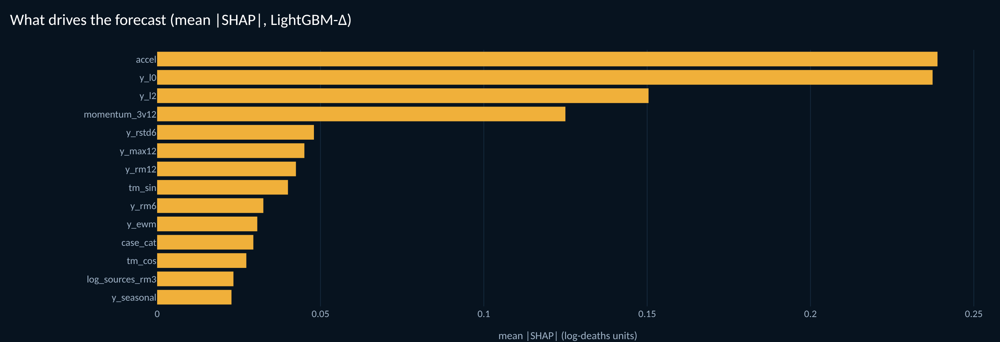<figcaption>Figure 17 – Mean |SHAP| for the LightGBM-Δ forecaster</figcaption></figure>


**Forward forecast (all data, refitted):**

| Conflict | Month | Forecast deaths | 80% low | 80% high |
|---|---|---|---|---|
| Afghanistan–Pakistan | Oct 2026 | 318 | 155 | 786 |
| Afghanistan–Pakistan | Nov 2026 | 316 | 143 | 1,428 |
| Afghanistan–Pakistan | Dec 2026 | 291 | 132 | 1,313 |
| Israel–Hamas | Oct 2026 | 128 | 62 | 317 |
| Israel–Hamas | Nov 2026 | 129 | 58 | 583 |
| Israel–Hamas | Dec 2026 | 123 | 55 | 557 |
| Russia–Ukraine | Oct 2026 | 6,780 | 3,316 | 16,708 |
| Russia–Ukraine | Nov 2026 | 6,765 | 3,071 | 30,447 |
| Russia–Ukraine | Dec 2026 | 6,735 | 3,058 | 30,316 |
| US–Iran | Oct 2026 | 26 | 12 | 66 |
| US–Iran | Nov 2026 | 26 | 11 | 122 |
| US–Iran | Dec 2026 | 24 | 11 | 114 |

## 8 · Early warning, scorecard and what-if

### 8.1 Sub-national escalation classifier
An area escalates next month if its deaths are ≥ 10 **and** ≥ 1.5 × its trailing 3-month mean (2–4% of area-months).
A regularised LightGBM classifier is fitted on 19 features (own intensity and momentum, conflict-wide tempo and spread,
country momentum, seasonality). It is trained on target months up to Dec *Y − 1* and tested on Jan–Sep *Y*, for
2023–2026. Features were chosen on 2023–25.

| 2026 withheld | ROC-AUC | PR-AUC | Brier | Top-10 precision | Top-20 recall |
|---|---|---|---|---|---|
| **LightGBM classifier** | **0.795** | **0.133** | 0.038 | **14.4%** | 32.7% |
| Logistic regression (5 signals) | 0.745 | 0.103 | 0.041 | 6.7% | 34.6% |
| Rule: last month's deadliest | 0.727 | 0.088 | 0.049 | 4.4% | 21.8% |
| Base rate | | 0.041 | | 4.1% | |

The top-10 list is **3.5× better than random** and
3.3× better than the rule of thumb. TreeSHAP's leading signals are
the area's smoothed intensity, **its country's** current intensity and momentum, and the **whole conflict's** momentum
and spread. Escalation is contagious within a theatre.


<figure><figcaption>Figure 18 – ROC and precision–recall on 2026 withheld months</figcaption></figure>


### 8.2 Watch-list for Oct 2026
The dashboard lists the 20 highest-risk areas. The top three are Kandahar, Balochistan and Kunar (Af–Pak,
21–23%), then Hormozgan (US–Iran, 16%) and Chernihiv, Dnipropetrovsk and Sumy (RU–UA, 14–15%).

### 8.3 Threat scorecard (RAG) rules
Points: **intensity** (next-month forecast ≥ 1,000 → 2; ≥ 100 → 1); **trend** against the last 6 months (≥ +20% → +1;
≤ −20% → −1); **hotspots** (named areas with escalation probability ≥ 15%: ≥ 3 → 2; ≥ 1 → 1); **spread** (more countries
than last year → 1); **volatility** (a ≥ 1,000-death month in the last year → 1). **RED** = forecast ≥ 1,000 a month or
≥ 5 points; **AMBER** = 2–4; **GREEN** ≤ 1. The rules are transparent and every input is a model output.

### 8.4 What-if simulator
The dashboard re-runs the selected ensemble on a modified history. Example: a +30% surge in Af–Pak deaths over three months
raises the Oct 2026 forecast by about 13% (318 → 359). The model damps short surges because most partly revert, while
sustained six-month surges carry through. A **live re-train** page fits LightGBM-Δ from scratch on any cut-off in about
2 seconds and scores it against naive.

## 9 · Recommendations

| Line of effort | Action | Lead [Domain] | When |
|---|---|---|---|
| **SENSE** | Use the monthly sub-national watch-list to task ISR and analyst effort; track *active sectors* and *countries hit*, not media volume | DIA / Service intelligence | Now (0–30 days) |
| **SENSE** | Build Indian OSINT coverage of the Gulf, Iran and Red Sea (Indian sources cover 17% of Af–Pak events and almost none elsewhere) | DIA / MEA | 90 days |
| **WARN** | Adopt the Af–Pak interstate dyad and KP/Balochistan escalation probabilities as standing LoC I&W indicators | Northern / Western Commands | Now |
| **WARN** | Publish the RAG scorecard monthly; escalate any move to RED or a rise in countries hit | HQ IDS | 90 days |
| **SHIELD** | Keep Gulf NEO plans current while US–Iran is AMBER; pre-position sealift/airlift options | HQ IDS / Navy / IAF / MEA | Now |
| **SHIELD** | Belligerent-movement picture for the IOR after the strike off Sri Lanka | Navy / IFC-IOR | 90 days |
| **SUSTAIN** | Buffer stocks and indigenisation of critical spares for Russian- and Israeli-origin platforms | MoD / DPSUs | 6–12 months |
| **SUSTAIN** | HADR kits weighted to women, children and under-fives; trigger on escalation flags, not death tolls | HQ IDS / NDMA | 6–12 months |

## 10 · Assumptions and limitations

* UCDP records **reported** lethal organised violence. Coverage depends on access and sources, and recorded side-specific
  attrition reflects reporting asymmetry.
* 2026 data are **provisional** (Candidate) and are usually revised upward. Holdout error includes revision noise.
* Over 90% of 2026 RU–UA deaths have no sub-national location, so sub-national claims about Ukraine rest on events.
* The US–Iran focal dyad codes **Israel and the US as one actor**, so no country split is possible.
* Displacement stocks cannot be attributed to single events. IDMC and UNRWA series are kept separate.
* World Bank context ends in 2025 and is used with a one-year lag.
* Forecasts cannot anticipate political decisions to start wars. That risk sits in the wide 95% tail.
* [Domain] statements are expert reasoning and are labelled as such.

## 11 · Reproducibility

```
pip install -r requirements.txt
python run_pipeline.py          # ~2.5 min: clean → features → insights → models → scorecard → figures
streamlit run app/app.py        # dashboard (works offline)
jupyter lab notebooks/          # 01–05, each re-runs its stage with commentary
```

Seeds are fixed (`random_state = 42`). Paths resolve automatically, or set `CONFLICT_DATA_DIR`. Source CSVs are read-only.
Every table in this report is in `outputs/tables/`, and every figure is in `outputs/figures/` (PNG + interactive HTML).
Run time on a laptop: about 66 s for modelling, 2–3 min end to end.

## Appendix A · Data-quality log (issues found)

| id | table | check | rows_affected | pct_affected | action |
|---|---|---|---|---|---|
| DQ05 | conflict_events | Out-of-order low/best/high estimates (low<=best<=high violated) | 692 | 1.13 | Raw values preserved. Corrected copies deaths_low_c = min(low,best,high) and deaths_high_c = max(low,best,high); row flagged flag_estimate_order. |
| DQ07 | conflict_events | Event date range crosses a month boundary | 731 | 1.20 | Fatalities allocated across months in proportion to days in range (uniform-day disaggregation) instead of assigning everything to the start month. |
| DQ08 | conflict_events | Date range extends beyond the 30 Sep 2026 extract window | 1 | 0.00 | Kept. Only the in-window share of deaths enters the monthly panel; out-of-window share is logged. |
| DQ09 | conflict_events | Low date precision (code 4-5: month or longer) | 792 | 1.30 | Kept and flagged. Used as a feature (share of imprecise events = reporting fog). |
| DQ10 | conflict_events | Provisional UCDP Candidate records (Jan-Sep 2026) | 4,644 | 7.61 | Flagged is_provisional. 2026 is used ONLY as the withheld test set, never for training the evaluated models. |
| DQ11 | conflict_events | UCDP coding status under review ('Check ...') | 176 | 0.29 | Kept and flagged flag_coding_check; sensitivity analysis excludes them. |
| DQ12 | conflict_events | Blank location_iso3 (code 666 ambiguous / international waters or airspace) | 38 | 0.06 | Imputed join key: 'INTL' for international waters/airspace (precision 7), 'XXX' for ambiguous code 666. Source labels retained. |
| DQ13 | conflict_events | Administrative boundary change: FATA merged into Khyber Pakhtunkhwa (2018) | 602 | 0.99 | Harmonised FATA to 'Khyber Pakhtunkwa province' (post-merger boundary) for a stable sub-national panel; raw admin1_name retained. |
| DQ14 | conflict_events | Blank admin1_name | 3,043 | 4.98 | Imputed category '(country-level / unspecified)' so the events remain in sub-national panels. |
| DQ15 | conflict_events | Aggregate event records (event_clarity = 2) | 5,757 | 9.43 | Kept (they carry real deaths) and flagged; event COUNT features use clear events only. |
| DQ16 | conflict_events | Extreme fatality records (> 99.9th pct = 1225) | 62 | 0.10 | Kept: verified as multi-day aggregates (mostly RU-UA front-wide monthly totals). Models use log1p target and robust (MAE-based) evaluation. |
| DQ17 | conflict_events | Zero-fatality events (deaths_best = 0) | 1,294 | 2.12 | Kept: UCDP retains events whose best estimate is 0 if low/high > 0 or in an active dyad. |
| DQ18 | conflict_events | Monthly allocation outside panel window (after Sep 2026) | 1 | 0.00 | Dropped allocation rows after the window (0.5 deaths, i.e. the October share of a September-start record). |
| DQ22 | event_sources | Publisher labels with spreadsheet 'Source:' prefix | 870 | 1.02 | Prefix stripped in publisher_norm. |
| DQ23 | event_sources | Publisher name variants (e.g. ITAR-TASS/Tass, UA Losses/UALosses) | 90 | 5.25 | Normalised 1,714 raw labels to 1,624 outlets (case, punctuation, prefix, alias map). |
| DQ24 | event_sources | Same outlet + same date repeated within one event | 7,515 | 8.80 | Kept (README: references can repeat an outlet/date) but flagged; 'unique outlets' feature de-duplicates them. |
| DQ25 | event_sources | Reference published before the event's end date | 253 | 0.30 | Kept (README: references may precede an event, e.g. aggregate updates). Lag clipped at 0 for reporting-latency statistics. |
| DQ27 | bilateral_displacement_stocks | Blank other_international_protection (source dash) | 6,269 | 99.94 | Imputed 0: in UNHCR tables a dash denotes nil / not applicable (documented in data dictionary). Flag retained. |
| DQ29 | unhcr_demographics | Unspecified sex/age cells ('_X') | 6,596 | 33.26 | Kept as an explicit 'Unspecified' level; shares computed over specified cells only and coverage reported alongside. |
| DQ30 | displacement_reference_stocks | Two non-comparable series (IDMC IDPs vs UNRWA registrations) | 112 | 100.00 | series_code kept as a key on every summary; the series are never summed. |
| DQ31 | displacement_reference_stocks | Unknown reporting area (UNK) | 1 | 0.89 | Kept in series totals, excluded from country joins. |
| DQ33 | country_year_context | Missing gdp_growth_annual_pct | 36 | 2.04 | Within-economy linear interpolation + edge fill; 12 remain blank (economy has no value in any year) and are left missing. |
| DQ34 | country_year_context | Missing consumer_inflation_annual_pct | 124 | 7.03 | Within-economy linear interpolation + edge fill; 60 remain blank (economy has no value in any year) and are left missing. |

## Appendix B · Metric definitions
MAE = mean |error|; RMSE = √mean(error²); MAPE = mean |error|/actual over months with actual > 0; sMAPE = mean
2|e|/(|y|+|ŷ|); MASE = MAE / in-sample MAE of the one-step naive; RMSLE = √mean(log(1+ŷ) − log(1+y))²; coverage = share
of actuals inside the interval; ROC-AUC/PR-AUC for ranking; Brier = mean squared probability error; precision@10 =
share of each month's top-10 areas that escalated.
